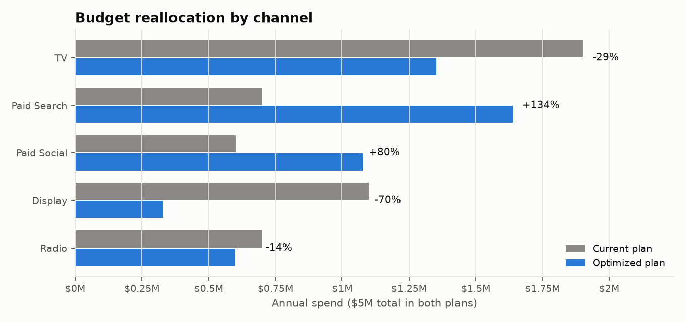
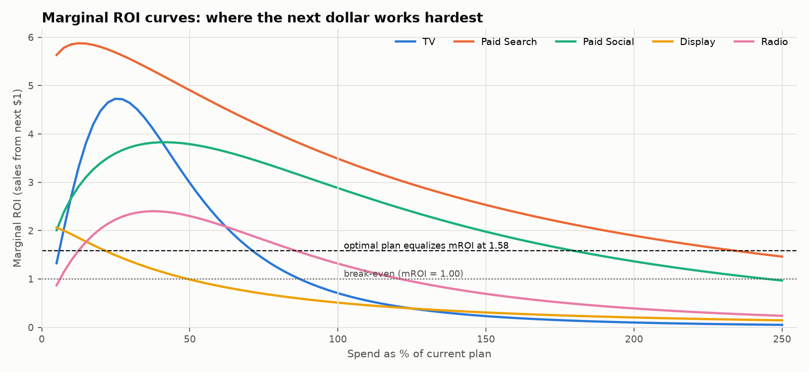

# Omnichannel Ad Spend & ROI Simulator

A Marketing Mix Model (MMM) for **5 promotional channels across 4 regional
markets**. It quantifies the incremental sales and ROI of each channel, using
**Adstock carry-over** and **Hill saturation** curves to capture diminishing
returns. A **non-linear SciPy optimizer** then reallocates a **$5M annual
budget**. An **interactive Power BI simulator** built on DAX what-if parameters
lets stakeholders explore spend scenarios and marginal ROI live.

**Skills:** Marketing Mix Modeling · Promotional ROI · Non-Linear Optimization · Python · SciPy · Power BI · DAX

## Headline results

| | Current plan | Optimized plan |
|---|---|---|
| Annual budget | $5.00M | $5.00M |
| Projected incremental (media-driven) sales | $12.69M | $14.58M |
| Average ROI | 2.54 | 2.92 |
| **Incremental sales lift** | | **+14.8%** (90% CI 9.0% – 18.1%) |
| Total sales lift (base + media) | | +3.8% |

The optimizer moves budget out of **TV** (past saturation: marginal ROI below
1.0 at current spend) and **Display** (lowest ROI) into **Paid Search** and
**Paid Social**. Those two still sit on the steep part of their response
curves. At the optimum, every unconstrained line item earns the same marginal
ROI of **1.58**, which is the KKT optimality condition, verified
numerically.

> **The 14.8% is a lift in media-driven (incremental) sales**, not total sales.
> Reallocating a fixed budget only moves the media contribution, so total sales
> rise by +3.8%.




## Method

### 1. Data
The project runs on **simulated** weekly data: 156 weeks × 4 regions × 5
channels (`mmm/data_generator.py`), generated from known ground-truth curves.
That allows the model to be audited against truth, which real data never
allows. The simulation includes realistic MMM difficulties:

* TV flighting (4 weeks on / 2 off), random Radio pulses, always-on digital with
  heavy week-to-week variation, and Search spend that follows demand
  seasonality (a real confound).
* Trend, yearly seasonality, holiday weeks, regional price index and promo
  price cuts.
* **Geo go-dark tests**: twice a year one region pauses each digital channel
  for 4 weeks. Without low-spend periods, an always-on channel's contribution
  is collinear with the intercept and cannot be identified. Real MMM teams
  calibrate with exactly these regional holdouts.
* Region-specific channel efficiency and a legacy, TV/Display-heavy media mix.

### 2. Model (`mmm/model.py`, `mmm/transforms.py`)

```
y[t,r]/ȳ[r] = α[r] + γ·controls[t,r]
            + Σ_c β[c,r] · Hill( Adstock(x[c,·,r]; θ_c)[t] / n[c,r] ; K_c, S_c ) + ε
```

* **Adstock:** normalized geometric decay, `a[t] = θ·a[t-1] + (1-θ)·x[t]`. A
  constant spend `x` has steady-state adstock `x`, so `K` stays in spend units.
* **Hill saturation:** `h(u) = u^S / (u^S + K^S)`. `K` is the half-saturation
  point in multiples of typical weekly spend, and `S > 1` gives an S-curve.
* Curve shapes (θ, K, S) are shared across regions. Effects β[c,r] are
  region-specific, ≥ 0, and **partially pooled on the ROI scale** toward the
  channel's national ROI (a ridge form of a hierarchical prior).
* **Estimation** by variable projection. SciPy `differential_evolution`
  searches the 15 non-linear parameters globally (polished with L-BFGS-B). For
  each candidate, the linear part is solved exactly by bounded least squares.
  The objective is a MAP posterior: profiled Gaussian likelihood plus
  weakly-informative log-normal priors on K and S.
* **Uncertainty:** a 200-replicate moving-block residual bootstrap. Each
  replicate is a full non-linear refit, run in parallel.

### 3. Optimization (`mmm/optimizer.py`)

```
max  Σ_i 52·β_i·Hill(X_i / (52·n_i))     s.t.  Σ_i X_i = $5M,   0.3·X_i⁰ ≤ X_i ≤ 2.5·X_i⁰
```

There are 20 decision variables (channel × region line items). The problem is
solved with SciPy **SLSQP** using analytic gradients (the marginal ROI). It is
**multi-started** because S-shaped Hill curves make it non-concave, then
verified with the **KKT conditions**. The guardrails (no line item cut by more
than 70% or scaled past 2.5×) keep the plan executable. A budget sweep produces
the efficiency frontier from $2.5M to $8M.

## Validation

| Check | Result |
|---|---|
| In-sample fit (national weekly) | R² 0.993, MAPE 1.45% (region-weeks), Durbin-Watson 2.21 |
| **Out-of-sample**: fit on 130 weeks, forecast last 26 | MAPE 1.56%, R² 0.989 |
| Global search vs truth | Fitted posterior ≥ posterior at the true parameters (no optimizer failure) |
| Channel ROI vs ground truth | Within ±7.3% for all 5 channels (TV −0.3%, Search +5.2%, Social −6.0%, Display +6.9%, Radio −7.3%); every true ROI lies inside its 90% bootstrap CI |
| Optimizer | 24/24 starts converged; KKT gap 7.9e-9 |
| **Recommended plan under the *true* curves** | delivers **+13.5%** lift (true optimum +13.8%) |
| DAX vs Python | `simulate_like_dax` mirrors every simulator measure; `ScenarioTests.csv` gives expected values to check in Power BI |

**Limitations, stated plainly:**

* The model projection (+14.8%) runs about 1.3 pp ahead of what the plan
  delivers under ground truth (+13.5%). This is normal estimation error,
  and the bootstrap interval covers it.
* Display's adstock decay is weakly identified (smallest signal), though its
  ROI is recovered tightly.
* Planning assumes flat weekly flighting (steady-state adstock).

## Power BI simulator

`run_pipeline.py` writes a ready semantic model as a **Power BI Project**:
`powerbi/OmnichannelROISimulator.pbip` (TMDL). It contains 11 tables, 10
relationships, 5 DAX what-if spend parameters (0–250% per channel), a plan
selector (Current / Optimized), a response-curve axis and 36 measures. The
measures **re-evaluate the fitted Hill curves in DAX**, so every slider move
returns exact incremental sales, ROI and **marginal ROI**. See
[powerbi/BUILD_GUIDE.md](powerbi/BUILD_GUIDE.md) for the 4-page layout, and
[powerbi/DAX_Measures.dax](powerbi/DAX_Measures.dax) for all measures.

## Run it

```powershell
cd "Omnichannel Ad Spend ROI Simulator"
..\.venv\Scripts\python.exe -m pip install -r requirements.txt
..\.venv\Scripts\python.exe run_pipeline.py          # ~3 min on 16 cores
..\.venv\Scripts\python.exe -m pytest -q             # 28 tests, ~1 min
```

## Project layout

```
mmm/
  config.py          scenario, guardrails, priors, ground truth
  data_generator.py  simulated regional weekly data (+ ground truth)
  transforms.py      Adstock, Hill, Hill derivative
  model.py           MMM estimation (DE + variable projection, MAP, pooling)
  uncertainty.py     parallel moving-block bootstrap
  optimizer.py       SLSQP budget allocation, KKT check, frontier
  powerbi_export.py  CSV star schema, DAX measures, PBIP/TMDL writer
  viz.py             report figures
run_pipeline.py      end-to-end pipeline
outputs/             summary.json, channel_summary.csv, optimal_allocation.csv, figures/
powerbi/             .pbip project, data/*.csv, DAX_Measures.dax, theme.json, BUILD_GUIDE.md
tests/               transforms, optimizer, model recovery, DAX static + parity checks
```
